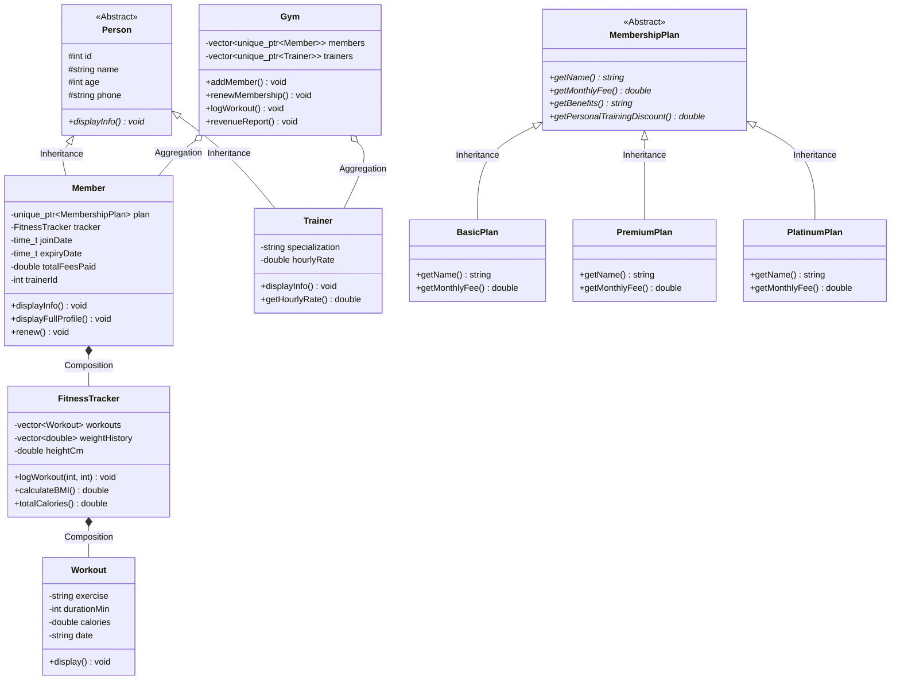

# Gym Membership & Fitness Tracker System
### College Object-Oriented Programming (OOP) Project in C++

---

## 🌟 1. Project Overview & Aim
The **Gym Membership & Fitness Tracker System** is an enterprise-grade console application engineered in **C++ (C++14)** to model gym facility operations, membership subscriptions, trainer assignments, and biometric workout tracking.

The application serves as a comprehensive academic demonstration of the **Five Core Pillars of Object-Oriented Programming (OOP)**:
1. **Abstraction**
2. **Encapsulation**
3. **Inheritance**
4. **Polymorphism (Runtime Dynamic Dispatch)**
5. **Composition (Has-a Relationship)**

---

## 🏗️ 2. Object-Oriented Design & Architecture

### Class Hierarchy & Architecture Diagram



---

## 💡 3. Mapping of OOP Principles to Code

### A. Abstraction
* **Definition:** Hiding implementation details and exposing only the essential interface to the user.
* **In Code:**
  * `class Person`: Contains pure virtual function `virtual void displayInfo() const = 0;`. An instance of `Person` cannot be instantiated directly.
  * `class MembershipPlan`: Pure virtual interface enforcing contracts (`getName()`, `getMonthlyFee()`, `getBenefits()`).

### B. Encapsulation
* **Definition:** Bundling data and methods operating on that data within a class while restricting direct external access via access specifiers (`private`, `protected`).
* **In Code:**
  * Member attributes such as `weightHistory`, `totalFeesPaid`, and `hourlyRate` are marked `private`.
  * Public getters/setters (`calculateBMI()`, `updateWeight()`) validate values and maintain class invariants.
  * Robust helper functions (`readInt()`, `readDouble()`) prevent stream buffer corruption from invalid inputs.

### C. Inheritance
* **Definition:** Creating new classes based on existing classes to reuse code and establish hierarchical relationships.
* **In Code:**
  * **Person Hierarchy:** `class Member : public Person` and `class Trainer : public Person` inherit common attributes (`id`, `name`, `age`, `phone`).
  * **Plan Hierarchy:** `BasicPlan`, `PremiumPlan`, and `PlatinumPlan` derive from `MembershipPlan`.

### D. Polymorphism (Runtime Dynamic Binding)
* **Definition:** The ability of different derived classes to respond to the same interface call in their own specific way through virtual tables (`vtable`).
* **In Code:**
  * `virtual void displayInfo() const override`: Invoked uniformly over `vector<unique_ptr<Person>>` or `vector<unique_ptr<Member>>`, dynamically executing the derived class method at runtime.
  * **Virtual Destructors:** `virtual ~Person() {}` and `virtual ~MembershipPlan() {}` guarantee correct polymorphic memory deallocation.

### E. Composition ("Has-A" Relationship)
* **Definition:** A design technique where a complex object contains instances of other classes as member variables, controlling their lifecycle.
* **In Code:**
  * A `Member` **has a** `FitnessTracker` object (`FitnessTracker tracker;`).
  * A `FitnessTracker` **has a** collection of `Workout` objects (`vector<Workout> workouts;`).

---

## ⚡ 4. Key Functional Features
1. **Membership Management**:
   * Registration with automatic unique ID generation (`1001`, `1002`, ...).
   * Plan tiers (Basic: ₹1,000, Premium: ₹2,000, Platinum: ₹3,500).
   * Renewal mechanism with automatic duration and fee extension.
   * Expiry tracking with remaining days calculation.
2. **Trainer Administration**:
   * Specialization (Cardio, Strength, Yoga, HIIT) and hourly fee settings.
   * Plan-based discount calculation for personal training (e.g., Platinum gets 25% off).
3. **Fitness Tracking Engine**:
   * MET-based (Metabolic Equivalent of Task) calorie burning formula:  
     $$\text{Calories} = \text{MET} \times \text{Weight (kg)} \times \left(\frac{\text{Duration (min)}}{60}\right)$$
   * Real-time Body Mass Index (BMI) computation:  
     $$\text{BMI} = \frac{\text{Weight (kg)}}{\left(\frac{\text{Height (cm)}}{100}\right)^2}$$
   * Workout history log with date and duration.
   * Leaderboard of top members ranked by total calories burned.
4. **Data Export & Reporting**:
   * Revenue analytics (active vs expired subscriptions, total revenue collected).
   * Persistent text file export (`gym_report.txt`).

---

## 🚀 5. How to Run

### Mode A: Interactive Web Application (Recommended for Presentations)
1. Double-click [start_website.bat](start_website.bat) inside the project folder, or run:
   ```bash
   python -m http.server 4000
   ```
2. Open your web browser at: **[http://localhost:4000](http://localhost:4000)**
3. Alternatively, you can simply double-click [index.html](index.html) to open the dashboard directly!

### Mode B: C++ Console Application
1. Double-click [run.bat](run.bat) inside the project directory, or compile manually:
   ```bash
   cd C:\Users\SARVADNYA\.gemini\antigravity-ide\scratch\gym-membership-fitness-tracker
   g++ -std=c++14 gym_management.cpp -o gym.exe
   .\gym.exe
   ```

# Compile using MinGW g++ with C++14 standard
g++ -std=c++14 gym_management.cpp -o gym.exe

# Execute the program
gym.exe
```

---

## 🎓 6. College Viva / Oral Examination Q&A Guide

| Question | Answer for Examiner |
| :--- | :--- |
| **Q1. Why are virtual destructors used in `Person` and `MembershipPlan`?** | Without a `virtual` destructor, deleting a derived object (like `Member`) via a base class pointer (`Person*`) causes **undefined behavior** and memory leaks because only the base destructor is invoked. `virtual ~Person()` ensures the complete destructor chain is called. |
| **Q2. What is the difference between Abstraction and Encapsulation in this project?** | **Abstraction** solves the design-level problem *"what does the class do?"* by exposing pure virtual methods in `Person` and `MembershipPlan`. **Encapsulation** solves the implementation problem *"how are the internals protected?"* by keeping `weightHistory` and `totalFeesPaid` private. |
| **Q3. Why did you use `std::unique_ptr` instead of raw pointers (`new`/`delete`)?** | `std::unique_ptr` provides **RAII (Resource Acquisition Is Initialization)**. It guarantees automated memory cleanup when objects leave scope, completely eliminating manual `delete` calls and memory leaks. |
| **Q4. What is Composition vs Inheritance here?** | Inheritance is an **"IS-A"** relationship (`Member IS-A Person`). Composition is a **"HAS-A"** relationship (`Member HAS-A FitnessTracker`). Composition provides loose coupling and higher flexibility. |
| **Q5. How is calorie expenditure calculated?** | Calorie burn is modeled on the clinical **MET (Metabolic Equivalent of Task)** standard multiplied by body weight in kg and workout hours: $\text{Calories} = \text{MET} \times W \times T$. |
